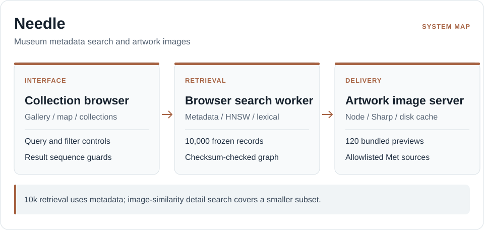

# Needle

**Explore 10,000 artworks from The Metropolitan Museum of Art.**

[Open Needle](https://needle.miguelalmeida.xyz) · [Architecture](docs/architecture.md) · [Operations](docs/operations.md)

Needle combines field-weighted museum metadata, lexical retrieval and a prepared HNSW graph to search a frozen artwork collection. Search runs in a browser worker; the Node server delivers the corpus, application and artwork images.

## Explore the collection

Search and filter works, open their details, save items to a collection and compare artworks. The gallery and spatial view render bounded sets of images instead of mounting all 10,000 records.

The main search is **metadata-based**. A separate image-detail feature compares color and texture across **262 locally indexed artworks**; it is not visual recognition across the full corpus.

## Engineering

- **Search integrity:** The worker checks corpus identity against the prepared graph and rejects stale search results.
- **Image delivery:** The server produces bounded AVIF/WebP/JPEG derivatives, caches them and falls back when museum images are unavailable. The first 120 opening previews are bundled.
- **Reproducible release:** `dist/` and `data-packs/` are part of the deployable package. They must not be discarded as disposable generated files. Editable presentation code lives in `src/redesign/`.

## Architecture

<p align="center">
  <picture>
    <source media="(max-width: 640px)" srcset="./docs/readme/architecture-mobile.svg">
    
  </picture>
</p>

[Search and caching details](docs/architecture.md)

## Run locally

Requires Node.js 26:

```sh
npm ci
npm run verify
npm run prepare:previews
npm start
```

Open the address printed by the server (normally `http://localhost:4173`). The bundled previews do not require a live museum request. [Docker and deployment instructions](docs/operations.md) are available separately.

## Boundaries

Opening images are local; other artwork images depend on The Met's availability. Experimental neural retrieval is not enabled on public hosts. The repository is an exported release package, not the original frontend development workspace; see the [documentation index](docs/README.md).

[MIT license](LICENSE) · [Artwork and dataset notices](THIRD_PARTY_NOTICES.md) · [Security](SECURITY.md)

Built by [Miguel Almeida](https://github.com/miguelalmeida0).
