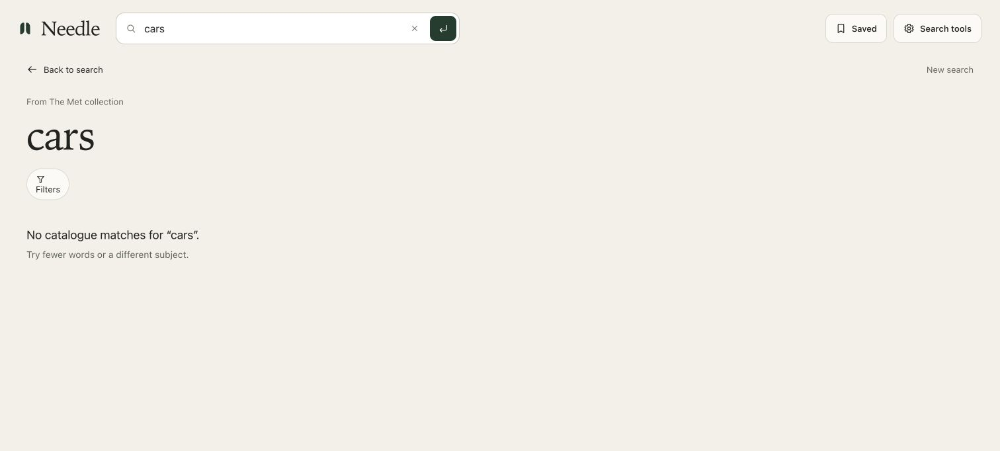

# Text search relevance correction

User authorization: 2026-10-22, replace the preserved search behavior with a relevance fix. Pre-fix HEAD: `ddec4b6acba619d736465770da59fe52fb7848cb`, clean working tree, branch `test`. Repository policy permits only `test` and `main`; no feature branch or history rewrite.

## Problem and cause

`cars` ranked an Emma Carson portrait because the old lexical title fallback accepts substrings (`dist/modules/packages/search-runtime/src/lexical-index.js`, title `includes`). Unsupported subjects have only residual hash coordinates in `art-semantic-encoder.js`; the old hybrid scorer returns nearest neighbours without requiring subject evidence. The wall then appends the entire 10K collection after the hits. Exact vector search does not fix missing subject evidence.

## Repair

A versioned engine in `src/search` adds whole-word postings, conservative plural/Unicode normalization, selected synonyms, quoted phrases, AND requirements, OR alternatives and coordinated exclusions. Every substantive positive group must have catalogue evidence. An unknown object cannot disappear because its color matched. Catalog filters apply before ranking. Title evidence is discounted for long credit/series strings so incidental title words do not outrank direct subject titles.

Supported text candidates retain a small vector tie-breaker and the existing graph trace. Image, artwork and mixed-query retrieval delegate to the original engine. Both the exported browser worker and local fallback resolve to the new engine through an explicit build binding. Worker and bootstrap are content-addressed; the original frozen runtime and graph remain available and byte-identical.

The main text wall shows only returned matching IDs. No matches produces an inline status and no filler images/map preview. Clearing search restores collection browsing. The positive map retains the user-requested, explicitly labelled unrelated collection context; empty searches do not get contextual images masquerading as matches.

## Verification and review

The original reproduction failed 8 new relevance tests before the fix, including cars, red cars, absent objects and saved-scope nonmatches. Added independent controlled examples for whole words, plurals, color/object conjunctions, exclusions, OR, quoted phrases, accents and creator names. Tests execute the shipped worker as well as checking local fallback resolution and the real wall rendering boundary.

Three read-only simplification reviews covered reuse, quality and resource usage, followed by a targeted manual correctness scan. Applied findings: remove retained per-document token maps; retain field weights with normalized fields instead of reconstructing them per phrase; correct coordinated exclusions; reject blank filter values; complete wall memo dependencies. The suggested removal of unrelated positive-map context was declined because the user expressly requested that labelled context. Kept two lines of wall response selection local to preserve its isolated renderer boundary.

Preservation tests remain intact and do not certify the new ranking by themselves. New relevance tests validate the corrected boundary. No new framework, model provider, paid infrastructure, data records or replacement images were introduced.

## Release and live evidence

`npm run verify` completed with **105 passed, 0 failed, 0 skipped**. The frozen runtime/data/image contracts, exported worker execution, local fallback binding, relevance regressions and wall/map state checks passed. Controlled regression cases establish these specific behaviors; they are not a universal search accuracy benchmark.

Production code commit: `460a69791bfe4da27991e9e764107af3322b8ed9`. Render deployment `dep-dbcrohivcj2c73flda90` became live on 2026-10-22 at 07:34:14 UTC. Verified the exact custom hostname `https://needle.miguelalmeida.xyz/` loaded `/assets/bootstrap-880A9278.js`, which binds the versioned worker `/assets/search-relevant-BA61762A.js`.

Completed live browser checks:

- `cars`: zero wall artworks, explicit no-catalogue-match status, no map-preview CTA. No Emma Carson false positive.
- `cats`: eight real result artworks, starting with *Feeding Poor Puss*, *A Woman and a Cat* and *A Boy with a Cat—Morning*. The wall does not append the 10K browse collection.
- `cats without dogs`: excludes the cat-and-dog candelabra work.
- Map for that positive query: eight marked matches among 132 real artworks, with the context explicitly labelled “Alongside the collection”; zero visible pending images at inspection.
- Changing that map query to `cars`: zero map artworks and the no-match message, followed by the results view on submission.

An additional post-release attempt to open an artwork was interrupted by a browser-tool connection stall; it is not counted as a completed live check. The original image/detail retrieval path is unchanged, and image/mixed-query delegation is covered by automated tests. The evidence-only documentation commit does not require a new application deployment.

## Prevention and confidence

Keep the whole-token, unknown-object, conjunction, exclusion and honest-empty-state regressions in the release check. Keep executing the shipped worker, rather than testing only an imported source class. Require catalogue evidence before vector tie-breaking and keep collection browsing distinct from active text results.

Confidence is high for the reproduced false-positive and filler-result defects and the covered parser boundaries. Confidence for arbitrary subject recall is limited by the existing catalogue metadata. No new model or independently labelled visual benchmark was introduced.

## Limits

This is precision-oriented catalogue retrieval. It deliberately returns fewer results when not all requested terms have evidence; it can miss relevant images whose metadata omit those terms. It does not provide general visual object recognition, typo correction, arbitrary natural-language understanding, or a guarantee for every query. The catalogue still contains no car-labelled records. No numerical universal accuracy claim is made from controlled examples or keyword-grounded checks.

For true image-content understanding beyond the catalogue, evaluate image-text embeddings and an independently labelled relevance set as a separate model/data change. Do not pass off hash residuals as general image understanding or silently fabricate missing collection subjects.
